<p align="center"></p>

<h1 align="center">dlus</h1>

<p align="center"><b>Downloads, streams and controls your LG TV from your Mac.</b><br>
A download manager that never starts over, a 4K HDR player for LG webOS TVs, subtitle auto-sync, a remote, and a VPN router for your TV - in one small app.</p>

<p align="center">
  <a href="https://github.com/amahbadi/dlus/releases/latest"></a>
  <a href="https://github.com/amahbadi/dlus/actions/workflows/ci.yml"></a>
  <a href="https://github.com/amahbadi/dlus/actions/workflows/security.yml"></a>
  <a href="https://github.com/amahbadi/dlus/actions/workflows/codeql.yml"></a>
  <a href="https://scorecard.dev/viewer/?uri=github.com/amahbadi/dlus"></a>
  <a href="https://www.bestpractices.dev/projects/16613"></a>
  <a href="https://github.com/amahbadi/dlus/releases"></a>
  
  
  <a href="LICENSE"></a>
  <a href="CONTRIBUTING.md"></a>
  <a href="https://claude.ai"></a>
</p>

<p align="center">
  <a href="https://github.com/amahbadi/dlus/releases/latest"></a>
</p>

<p align="center">
  <a href="#-what-it-does">✨ Features</a> ·
  <a href="#-screenshots">📸 Screenshots</a> ·
  <a href="#-install">📦 Install</a> ·
  <a href="docs/USER-GUIDE.md">📖 User guide</a> ·
  <a href="CHANGELOG.md">📝 Changelog</a> ·
  <a href="#-special-thanks">🎬 Special thanks</a>
</p>

<p align="center">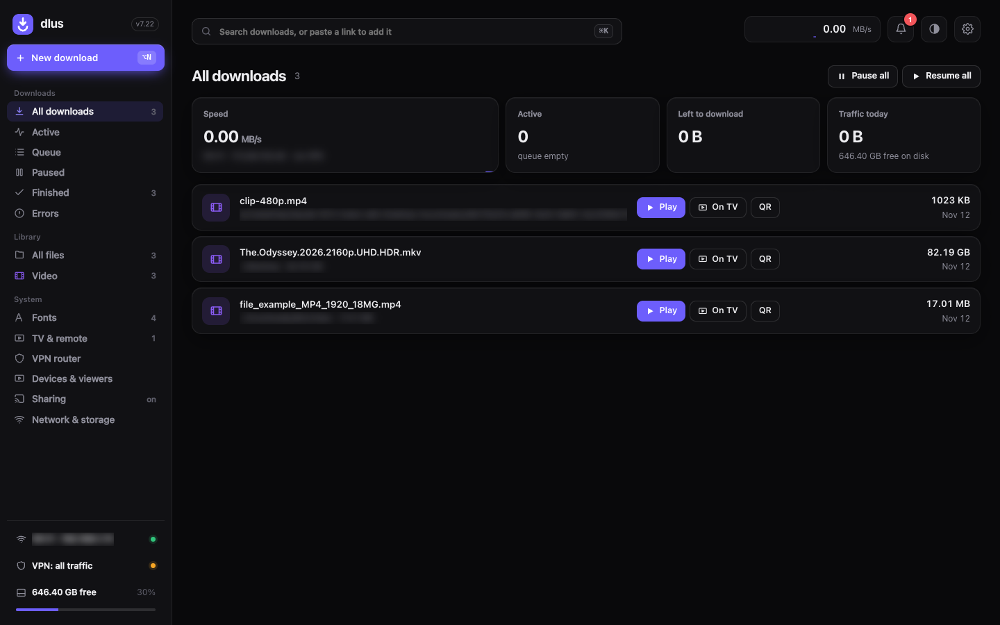</p>

---

## 🌊 Why dlus exists

> *The Odyssey* had just come out, and I wanted to watch it at home the way it deserves: the full 4K HDR copy, all ~88 GB of it. The connection was unstable. Every downloader I tried either started over after a drop, or silently corrupted the file - I found out only when the first gigabytes would not play.
>
> So I wrote a small script that downloads in many parts and checks every piece. Then I wanted to watch while it was still downloading. Then on the TV. Then with Persian subtitles that were actually in sync, a proper remote, and my VPN on the TV. A couple of days later that script had become **dlus** ("downloader for us"). 🍿

## ✨ What it does

<table>
<tr>
<td width="50%" valign="top">

### ⬇️ Downloads that finish
- **Many connections** per file; every piece is checked, so a resumed file is **never corrupted**
- Survives **Wi-Fi drops, sleep and restarts** - it continues where it stopped
- 🔐 **Checksums**: paste the publisher's, or dlus finds their checksum file itself; every file gets a **SHA-256**, a **Verify** button and the macOS quarantine flag
- Queue, folders, speed limit, schedule, live speed graph
- **Watch a film while it is still downloading**

</td>
<td width="50%" valign="top">

### 📺 Your LG TV (webOS)
- **Play on TV** with LG's own player - the original 4K HDR file, untouched, with your subtitle
- Or the **dlus player** on the TV: full-screen glass player with seek previews, resume, quality and sound choices, subtitle styles, one-press switch to LG's player
- **Remote control** on the Mac laid out like the LG Magic Remote: apps, inputs, typing, volume, screen off, picture mode
- **TV home page**: your films and shared folders on the TV

</td>
</tr>
<tr>
<td width="50%" valign="top">

### 💬 Subtitles
- **Search online**: every subtitle gets a match score for your exact release (**★ 100 %** = made for your very file)
- **Auto sync** from the film's speech: fixes shifts, wrong frame rates (25 vs 23.976 fps) and other cuts - and tells you when a subtitle belongs to another version
- One look (font, size, colour) for every film, Persian / Arabic fonts included

</td>
<td width="50%" valign="top">

### 🎞️ Every format · 🌐 Your network
- MP4, MKV, WebM, AVI, MOV - H.264, HEVC, VP9, AV1, ProRes: **converted only when a player cannot play it**
- Optional ✨ *Enhance* for low-resolution videos (upscaled to 1080p)
- DLNA server, folder sharing, an HTTP proxy - **all off until you turn them on, every device approved by you**
- 🛡️ **VPN router** *(experimental)*: send chosen devices - like the TV - through your Mac's VPN

</td>
</tr>
</table>

## 📸 Screenshots

| | |
|---|---|
| 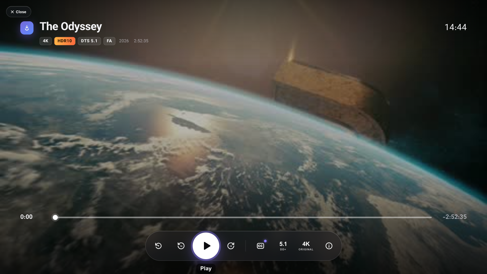<br>**The dlus player** - on the TV and the Mac | 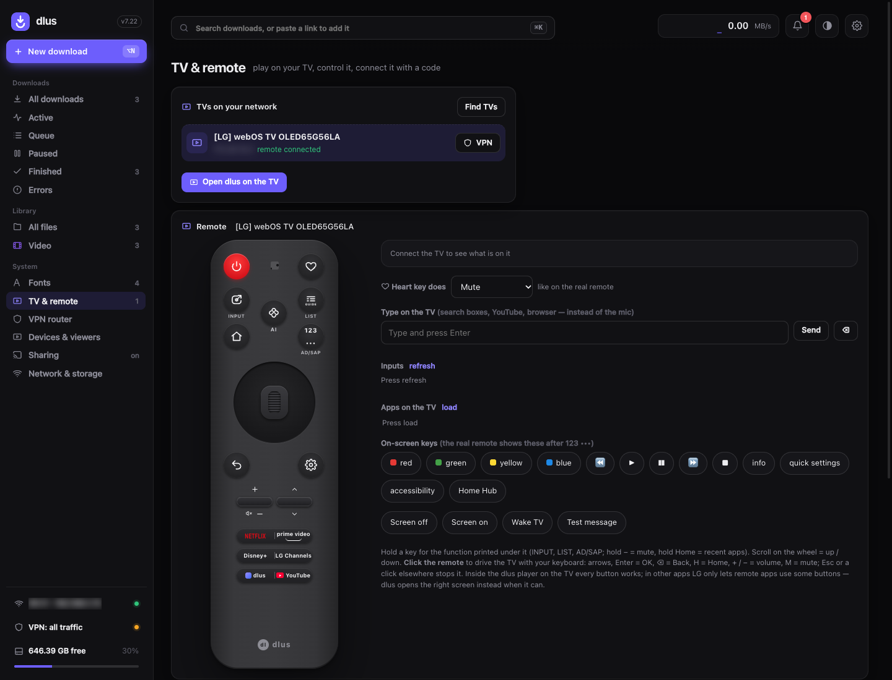<br>**TV & remote** - Magic Remote layout, apps, inputs, typing |
| <br>**Subtitles** - styles, sync, auto sync, online search | 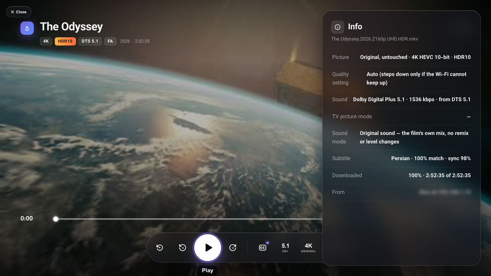<br>**What is playing** - original picture, sound, subtitle |
| 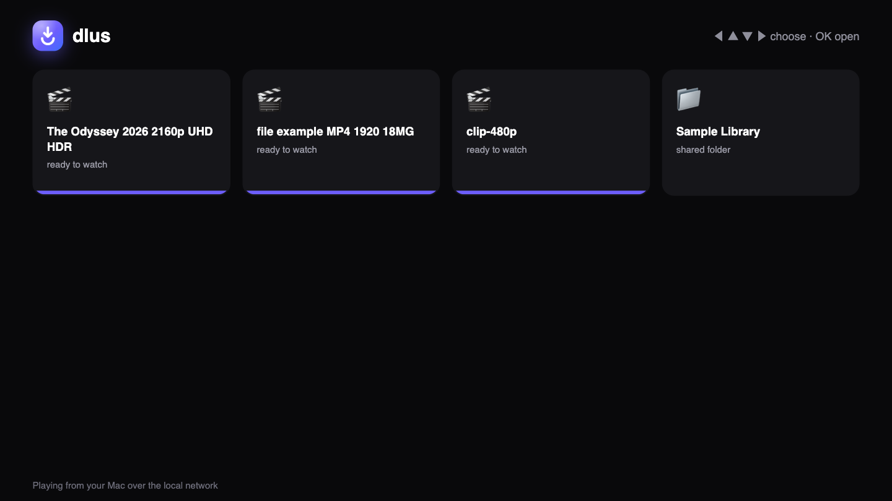<br>**TV home page** - films and shared folders on the TV | 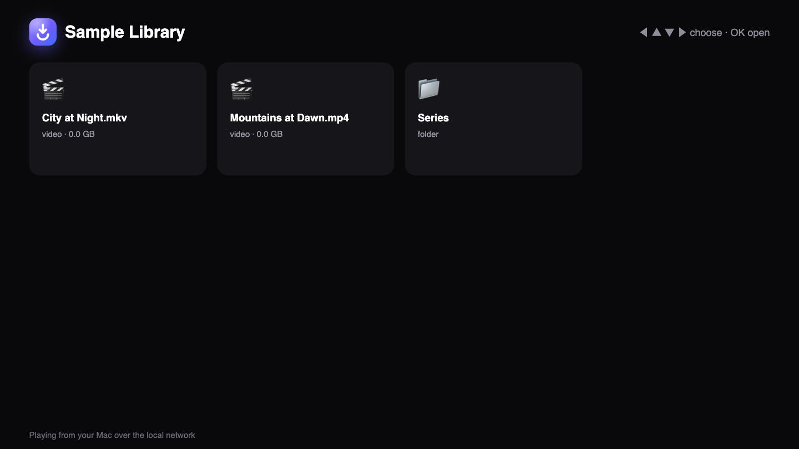<br>**Shared folder** on the TV |
| 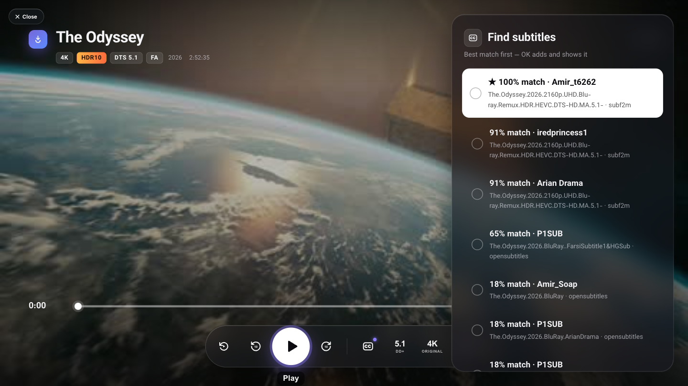<br>**Find subtitles** - every match scored, the exact release first | 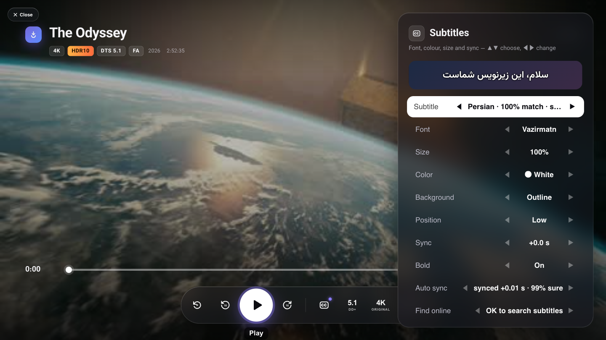<br>**Auto sync** - subtitle fitted to the film's speech |
| 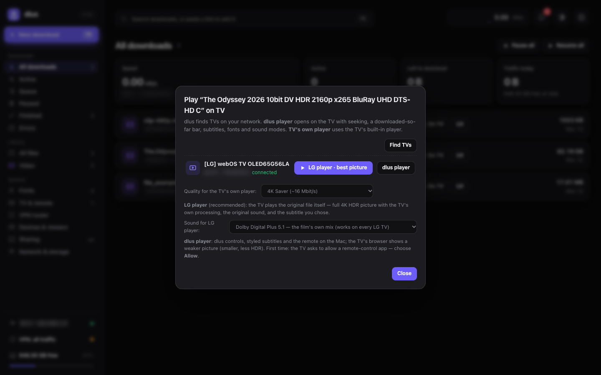<br>**Play on TV** - LG's own player or the dlus player | 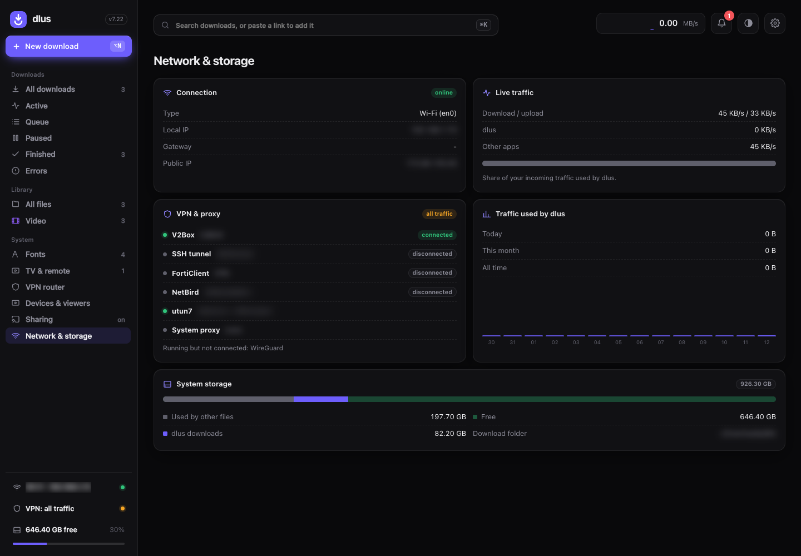<br>**Network & storage** - connection, VPNs, disk |
| 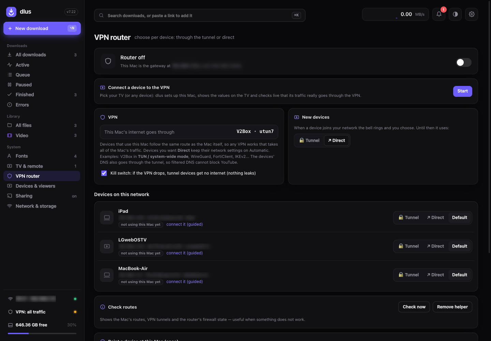<br>**VPN router** - send the TV through the Mac's VPN | 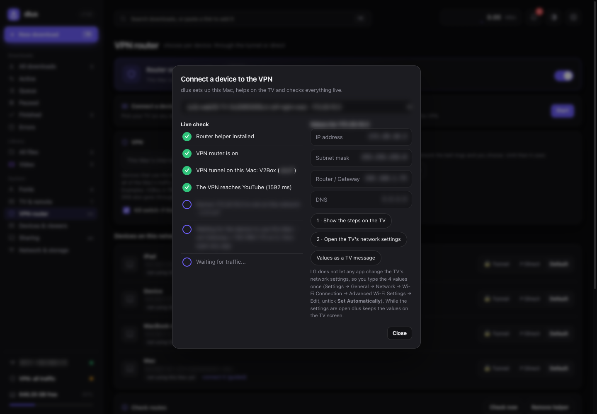<br>**Guided VPN setup** - with a live check |
| 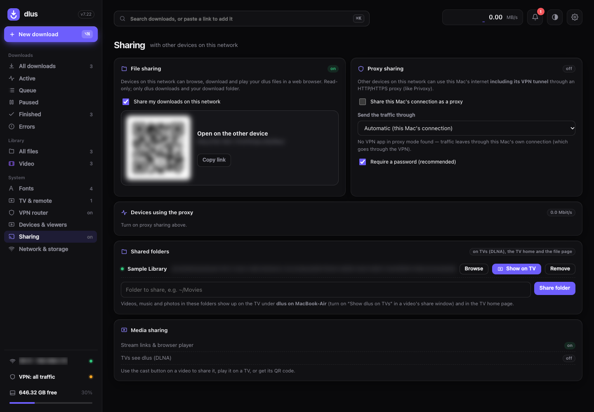<br>**Sharing** - folders, DLNA, proxy, QR links | 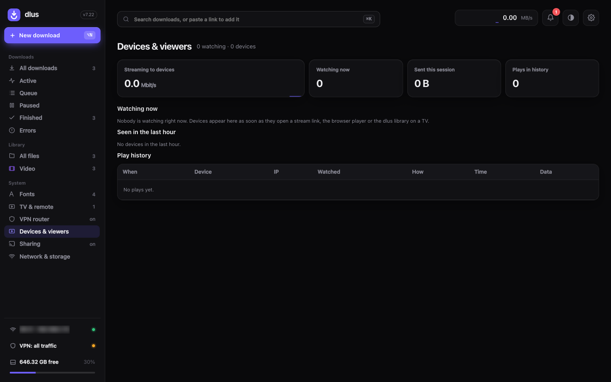<br>**Devices & viewers** - who watches what |
| 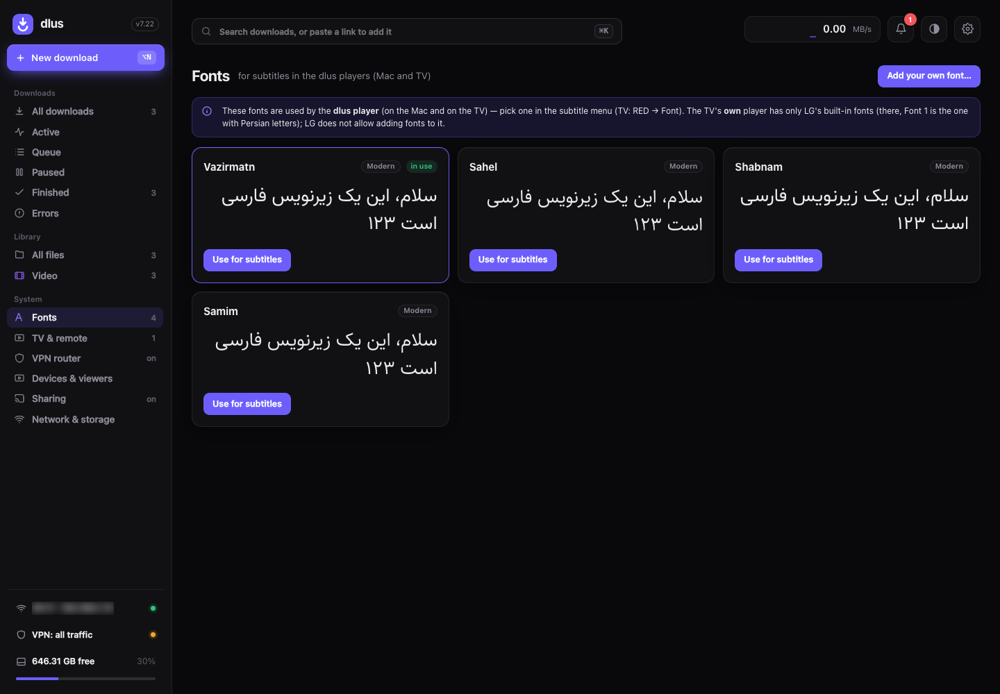<br>**Fonts** - Persian / Arabic subtitle fonts | 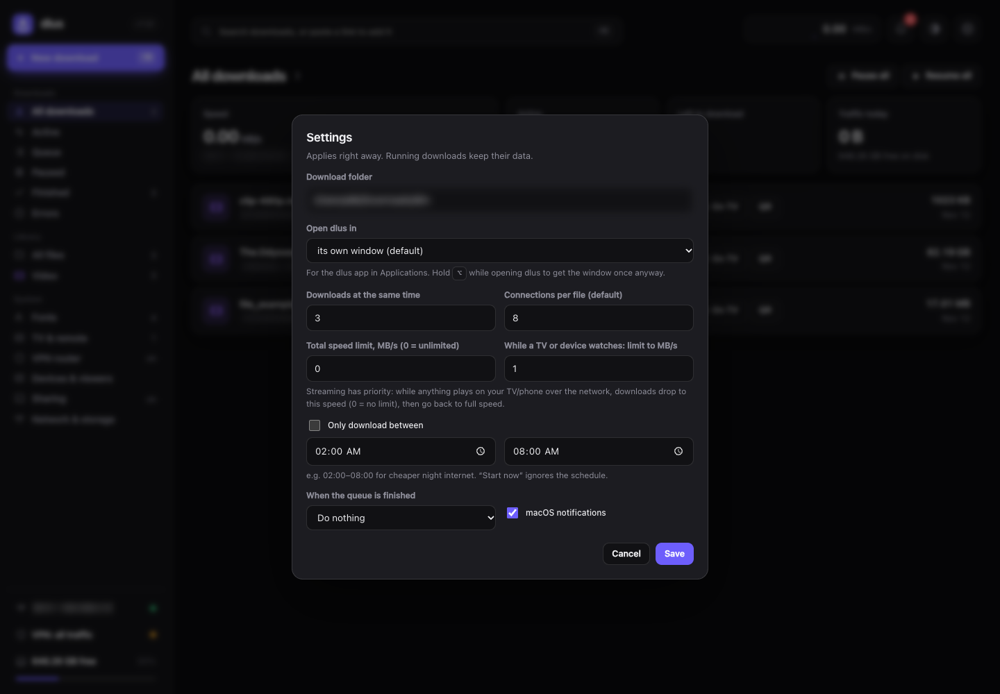<br>**Settings** |

## 📦 Install

1. Download **`dlus-<version>.dmg`** from [Releases](https://github.com/amahbadi/dlus/releases/latest)
2. Drag **dlus** onto **Applications** and open it
3. dlus opens in its own window and keeps working in the background, also when the window is closed

> [!IMPORTANT]
> **First start:** right-click **dlus** &rarr; **Open** &rarr; **Open** (the app is not notarized). Only once.

| Needs | |
|---|---|
| 🍏 macOS | 12 or newer (Apple silicon or Intel) |
| 🐍 Python 3 | built in with the developer tools: `xcode-select --install` |
| 🎬 [ffmpeg](https://ffmpeg.org) | for TV streaming, subtitles and previews: `brew install ffmpeg` |

**Updating:** download the new DMG and drag dlus onto Applications again (replace). Your downloads, settings and TV pairing stay; older settings are moved forward automatically. What changed: [CHANGELOG.md](CHANGELOG.md).

> [!TIP]
> **Check your download** - every release is built by GitHub Actions and signed:
> ```sh
> gh attestation verify dlus-<version>.dmg --repo amahbadi/dlus
> ```

## 🚀 Quick start

| I want to | Do this |
|---|---|
| ⬇️ download something | paste a link anywhere in dlus (<kbd>⌘</kbd><kbd>V</kbd>) or **New download** (<kbd>⌘</kbd><kbd>N</kbd>) |
| 🔐 check a downloaded file | open it &rarr; **Integrity** &rarr; paste the publisher's checksum &rarr; **Verify** |
| 💻 watch it on the Mac | **Play** on the file - it opens in its own player window |
| 📺 watch it on the TV | **On TV** &rarr; **LG player · best picture** |
| 💬 get subtitles in sync | in the player: **Subtitles &rarr; Find online**, then **Auto sync** |
| 🎮 control the TV | **TV & remote** |
| 🛡️ put the TV on my VPN | **VPN router &rarr; Connect a device** |
| ✅ let a new TV or phone in | press **Allow** on the banner that appears in dlus |

> [!NOTE]
> 📖 The full guide - every feature, setting and shortcut - is in **[docs/USER-GUIDE.md](docs/USER-GUIDE.md)**. Command line, local API, network addresses and files: **[docs/INTERFACES.md](docs/INTERFACES.md)**. What changed: **[CHANGELOG.md](CHANGELOG.md)**.

## 🧪 Tested with

| | |
|---|---|
| 📺 **TV** | LG OLED evo **G5** 65" (OLED65G56LA, 2025, webOS 25, browser engine Chrome 132) - LG's own player, the dlus player in the TV browser, DLNA, the remote API |
| 💻 **Mac** | MacBook Air, **Apple M5**, macOS 26.5.1 (Tahoe) - built and run on this Mac |
| 🧰 **Tools** | Python 3.14, ffmpeg 9.0.2 (Homebrew), Swift 6.3 (Xcode command line tools) |
| 📶 **Networks** | home Wi-Fi and an iPhone hotspot |
| 🎞️ **Formats** | 4K HDR10 HEVC MKV with DTS-HD MA (88 GB), plus test clips in MP4 / WebM / AVI / MKV (AV1) / MOV (ProRes) |

> [!NOTE]
> Other LG webOS TVs (2018 and newer) should work - the remote and the player use LG's standard interfaces - but they have not been tested. Intel Macs get the same universal app, also untested so far. Reports are welcome in [Issues](https://github.com/amahbadi/dlus/issues).

## 🔒 Privacy and security

- 🛡️ **Every device must be allowed by you** - even with the right code, a TV or phone waits for your **Allow** in the app; everything is in an **activity log**
- 🔐 **Downloads stay untouched** - checksums (yours or the publisher's), SHA-256 + Verify for every file, Gatekeeper quarantine, no https-to-http downgrade, disguised playlists refused
- 🏠 **Nothing is opened on your network until you allow it**; private folders (`~/.ssh`, `~/Library`, system folders) can never be shared
- 🔑 The dlus window talks to a service on `127.0.0.1` that needs a key only your macOS account can read; other users and websites cannot control it
- 🧱 The VPN router's root helper sits in a root-only folder, accepts only checked commands, and lets **only your chosen devices** route through the Mac
- 📺 The LG TV connection is pinned to the TV's certificate - no listening in
- 🤖 Every change is scanned: Bandit, Semgrep, CodeQL, Gitleaks, ShellCheck, fuzzing, security tests; releases carry a signed build provenance
- 🙈 No accounts, no telemetry; dlus talks to the internet only for your downloads and subtitle searches

> [!TIP]
> 🔎 How each of these works, and how to check them yourself: **[SECURITY.md](SECURITY.md)** · VPN router: [docs/VPN-ROUTER.md](docs/VPN-ROUTER.md). Found a problem? **[Report it privately](https://github.com/amahbadi/dlus/security/advisories/new)**.

## 🤝 Contributing

Issues and pull requests are welcome - see **[CONTRIBUTING.md](CONTRIBUTING.md)** · [Code of Conduct](CODE_OF_CONDUCT.md) · [Governance](GOVERNANCE.md) · [Architecture](docs/ARCHITECTURE.md) · [Assurance case](docs/ASSURANCE-CASE.md)

```text
fork → branch → pull request → 🤖 security checks comment on it → fix until ✅ → maintainer review → merge
```

## 🛠️ Build from source

```sh
python3 dlus.py              # run it directly: http://127.0.0.1:8642/
bash macos/build_dmg.sh      # dist/dlus.app + dist/dlus-<version>.dmg (universal, ad-hoc signed)
```

dlus is one Python file using only the standard library, plus `curl`, `ffmpeg` and a small Swift window (`macos/main.swift`).

| Workflow | Runs |
|---|---|
| [CI](.github/workflows/ci.yml) | every push and PR: compile, JavaScript check, security tests, firewall rules in macOS `pf`, Swift build |
| [Security](.github/workflows/security.yml) | every push, PR and weekly: Bandit, Semgrep, Gitleaks, ShellCheck, fuzzing |
| [CodeQL](.github/workflows/codeql.yml) · [Scorecard](.github/workflows/scorecard.yml) | GitHub code analysis and the OpenSSF rating |
| [Release](.github/workflows/release.yml) | a tag `v*`: builds the DMG, signs its provenance, publishes it |

## 💜 Thanks

dlus was designed and built together with **[Claude](https://claude.ai)** (Anthropic) in Claude Code - from the first resumable-download script to the TV player, the subtitle sync and the measurements behind them. Thank you, Claude.

## 🎬 Special thanks

<p align="center"><b>To Christopher Nolan's <i>The Odyssey</i> (2026).</b></p>

dlus exists because of one film. Wanting to see *The Odyssey* at home in full 4K HDR, the way it was meant to be seen, is what started the first download script, and everything else grew from there. Thank you to Christopher Nolan and everyone who made it. 🌊⛵

## 📄 License

[MIT](LICENSE) © Ali Akbar Mahbadi. Not affiliated with LG Electronics. LG and webOS are trademarks of LG Electronics.

---

<p align="center">Made with ❤️, 🍿 and a lot of subtitles.<br>
If dlus helped you, leave a ⭐ - it helps others find it.</p>
