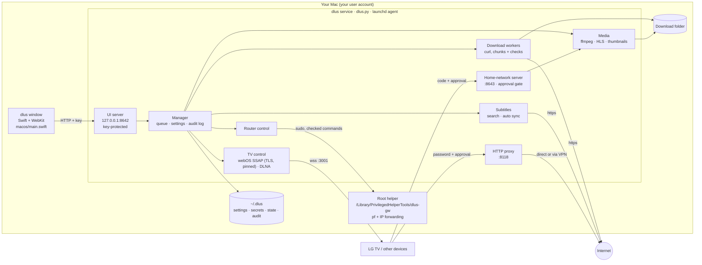

<h1 align="center">🏗️ Architecture</h1>

The high-level design of dlus: its parts, how they talk to each other, and where data lives. Interfaces in detail: <a href="INTERFACES.md">INTERFACES.md</a> · Security argument: <a href="ASSURANCE-CASE.md">ASSURANCE-CASE.md</a>

## 🗺️ Overview

## 🧩 Components

| Component | Where | Does |
|---|---|---|
| **Window** | `macos/main.swift` | native WebKit window; opens the UI server with the key; opens players in their own windows; links to the internet go to the normal browser |
| **Launcher** | `macos/setup.sh` | installs and starts the launchd agent (`com.dlus`) that keeps the service running |
| **UI server** | `dlus.py` (`make_handler`) | the dlus page and its JSON API on `127.0.0.1` only; key cookie, host and origin checks, security headers |
| **Manager** | `dlus.py` (`Manager`) | the central object: downloads, settings, secrets, approvals, activity log, scheduling, notifications |
| **Download workers** | `dlus.py` (`DL`) | one thread per download; 256 MB chunks over parallel `curl` connections; every chunk checked against the server; checksum, SHA-256 and quarantine at the end |
| **Media** | `dlus.py` (`probe`, `compat_cmd`, `HLS`) | `ffprobe`/`ffmpeg` for previews, converted streams and HLS for the TV browser; refuses disguised playlists |
| **Subtitles** | `dlus.py` (`subs_*`, `speech_map`) | online search with match scores, decoding, conversion to WebVTT, speech-based auto sync |
| **Home-network server** | `dlus.py` (`make_lan_handler`) | TV home page, players, streams, shared folders, DLNA; every request with the code passes the approval gate |
| **Proxy** | `dlus.py` (`Proxy`) | HTTP/CONNECT proxy for approved devices; never to the Mac itself |
| **TV control** | `dlus.py` (`WebOSTV`, DLNA cast) | LG remote API over WebSocket (TLS, certificate pinned at pairing); DLNA renderers for other TVs |
| **Router control** | `dlus.py` (`Gateway`) | per-device tunnel / direct lists; calls the root helper through `sudo -n` |
| **Root helper** | `gateway/dlus-gw` | the only code that runs as root: fixed commands, checked arguments, its own `pf` anchor |

## 💾 Data

| Where | What | Protection |
|---|---|---|
| `~/.dlus/` | everything dlus remembers | folder mode 700 |
| `settings.json`, `state.json`, `stats.json` | settings, download list, traffic | |
| `secrets.json`, `ui-key`, `media-key` | TV code, proxy password, TV pairing keys and certificates, window key, player key | mode 600, separate from settings |
| `audit.json`, `dlus.log` | activity log, technical log | one line per entry |
| download folder | finished files, `.parts/` while downloading | quarantine flag on finished files |

## 🔁 Main flows

- **Download:** link &rarr; `DL` asks the server for size and ranges &rarr; parallel chunks (`curl`) &rarr; each chunk checked &rarr; joined &rarr; checksum / SHA-256 &rarr; quarantine flag &rarr; done.
- **Watch on the TV:** TV opens `/<code>/tv` &rarr; approval gate &rarr; player page &rarr; stream (original file, converted, or HLS) read from the file, also while downloading.
- **Play on LG's player:** the Mac sends the stream URL to the TV over the pinned webOS connection; the TV fetches the file from the home-network server.
- **Router:** the user adds a device &rarr; `Gateway` calls `sudo -n dlus-gw set tunnel <ip>` &rarr; the helper updates its `pf` tables.

## 🧱 Design rules

- One Python file, **standard library only**; external programs (`curl`, `ffmpeg`, `pfctl` ...) are started with argument lists, never a shell.
- **Least privilege:** the service runs as the user; only the small helper runs as root, and only with checked commands.
- **Off by default, allow-list everywhere:** network features start off; devices, paths, interfaces, addresses and file names are checked against what is allowed.
- **Never lose data:** state is written atomically with a backup; downloads resume from their checked pieces.
