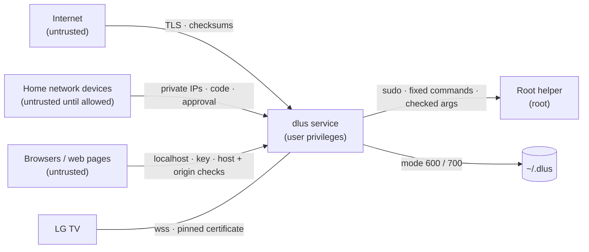

<h1 align="center">🛡️ Assurance case</h1>

Why we believe dlus meets its security requirements: the threats, the trust boundaries, the design principles applied, and how common weaknesses are countered. Short version for users: <a href="../SECURITY.md">SECURITY.md</a> · Design: <a href="ARCHITECTURE.md">ARCHITECTURE.md</a>

## 🎯 Security requirements

1. **R1 Integrity of downloads:** a finished file is exactly what the server (and, with a checksum, the publisher) provided; tampering is detected.
2. **R2 Control of the Mac:** nobody but the user can control dlus or read its secrets.
3. **R3 Home network:** only devices the user allowed can use what dlus shares, and only what was shared.
4. **R4 Root privileges:** the root helper cannot be used to do anything beyond its fixed purpose, by anyone.
5. **R5 No harm to the Mac's network:** the router never exposes the Mac or the VPN to devices the user did not choose, and can always be undone.
6. **R6 Supply chain:** a release is built from the published source and can be verified.

## 👿 Threat model

| Attacker | Can | Wants |
|---|---|---|
| **A1 Malicious or compromised server / mirror** | send any bytes, headers, redirects, file names | corrupt or replace a download, write outside the folder, trick ffmpeg |
| **A2 Network attacker** (public Wi-Fi, on-path) | read and change unencrypted traffic, block ports | downgrade to http, swap files, steal TV keys |
| **A3 Device on the home network** (guest phone, infected IoT device) | send any request to dlus' ports, guess codes, answer SSDP | watch films, read shared or private files, use the proxy or the Mac as a router, reach the Mac's own services |
| **A4 Malicious website** in the user's browser | send requests to `127.0.0.1` | control dlus (CSRF, DNS rebinding, clickjacking) |
| **A5 Other local program as the same or another user** | run commands, read files the OS allows | control dlus, abuse the root helper, read keys |
| **A6 Malicious contributor / dependency** | send pull requests, publish package updates | get vulnerable or malicious code into a release |

Out of scope: an attacker who already has administrator rights or the user's unlocked account (they can change dlus itself), and vulnerabilities inside macOS, curl, ffmpeg or the TV.

## 🚧 Trust boundaries

Every arrow into the service is a boundary where input is checked against an allow-list before use.

## 🧭 Secure design principles applied

| Principle (Saltzer & Schroeder) | In dlus |
|---|---|
| **Least privilege** | the service runs as the user; root only in a 180-line helper with a fixed command set; sudo allows only that file; GitHub workflows get read-only tokens |
| **Fail-safe defaults** | sharing, DLNA, proxy and router are off; new devices are denied until allowed; the kill switch blocks a tunnelled device's traffic when the VPN drops |
| **Complete mediation** | every network request with the code passes the approval gate; every file request passes `safe_join`; every helper argument is checked |
| **Economy of mechanism** | one file, standard library only; the helper is a short shell script with one `pf` anchor |
| **Open design** | all code, the pipeline and this case are public; security does not depend on secrecy of the code |
| **Separation of privilege** | changing the router needs the admin password once to install the helper, plus the user's session to call it |
| **Least common mechanism** | the UI server (localhost) and the home-network server are separate listeners with separate keys (UI key, media key, TV code) |
| **Psychological acceptability** | one Allow / Deny banner, a visible activity log, checksums checked automatically for installers |

## 🧪 Arguments per requirement

| Req. | Argument | Evidence |
|---|---|---|
| **R1** | chunks checked at several points against the server; size + ETag pinned; publisher checksum (pasted or found) compared in constant time; SHA-256 kept for later re-checks; mismatches set aside; quarantine flag keeps Gatekeeper in charge; https never downgrades | `DL.finish`, `parse_checksum`, tests `Checksums`, fuzz `fuzz_checksum.py` |
| **R2** | UI only on `127.0.0.1`; key in a mode-600 file; host and origin checks; `SameSite=Strict` cookie; anti-framing headers; secrets in `secrets.json` (600) | `make_handler.guard`, tests `Network` |
| **R3** | private addresses only; per-device approval tied to MAC; rate-limited codes; `safe_join` + no hidden files + no private folders; proxy blocks the Mac and rebinding; every action logged | `lan_access`, `gate`, `safe_join`, `share_ok`, tests `SharedFolders`, fuzz `fuzz_paths.py` |
| **R4** | root-only install folder (installer checks every parent); sudo rule for one file; fixed commands; regex + range checks on every argument; fixed `PATH` | `gateway/dlus-gw`, `install.sh`, tests `RootHelper`, ShellCheck, `pf` selftest in CI |
| **R5** | rules only in `com.apple/dlus`; unlisted devices dropped; forwarding restored on disable; no `route-to` (kernel panic); crash guard turns the router off after a panic | `rules()`, `disable`, VPN-ROUTER.md |
| **R6** | every change: CI, Bandit, Semgrep, CodeQL, Gitleaks, ShellCheck, fuzzing, tests; actions pinned to commits, scanners pinned by hash or digest; DCO; branch rules; releases built by Actions with SLSA provenance + Sigstore bundle | `.github/workflows/`, OpenSSF Scorecard, release assets |

## 🐛 Common weaknesses countered

| Weakness (CWE) | Countermeasure |
|---|---|
| Path traversal (CWE-22) | `safe_join` (real path must stay inside), `safe_name` for server names, hidden files refused |
| OS command injection (CWE-78) | argument lists only, never `shell=True`; checked by Semgrep and a test |
| Cross-site request forgery (CWE-352) | origin check, `SameSite=Strict`, key cookie |
| DNS rebinding / SSRF (CWE-350, CWE-918) | Host header allow-list; proxy connects to the checked address; discovery only to the answering device |
| Missing authentication (CWE-306) | UI key; TV code + device approval; proxy password + approval |
| Improper certificate validation (CWE-295) | system verification for all internet TLS; TV certificate pinned at pairing, no plain-text fallback |
| Downgrade / cleartext (CWE-757, CWE-319) | https redirects stay https; TLS 1.2 minimum to the TV |
| Integrity check missing (CWE-353, CWE-494) | chunk checks, checksums, SHA-256, quarantine |
| Log injection (CWE-117) | one-line formatter, `logsafe` |
| Open redirect / header injection (CWE-601, CWE-113) | redirect only to paths on the page, no line breaks |
| Resource exhaustion (CWE-400, CWE-409) | size limits on fetched text, subtitle archives limited to 30 MB unpacked, rate-limited codes |
| UI misrepresentation (CWE-451) | control and right-to-left characters removed from file names |
| Hard-coded / leaked credentials (CWE-798) | random secrets from `secrets`; Gitleaks + push protection |
| Privilege escalation via writable paths (CWE-732) | helper in a root-only folder; `~/.dlus` mode 700, secrets 600 |

## 🔍 Review

This case was written with the security review of release 7.23 (November 2026) and is updated whenever the threat model or a boundary changes. Remaining risks and planned work are in the [roadmap](ROADMAP.md).
