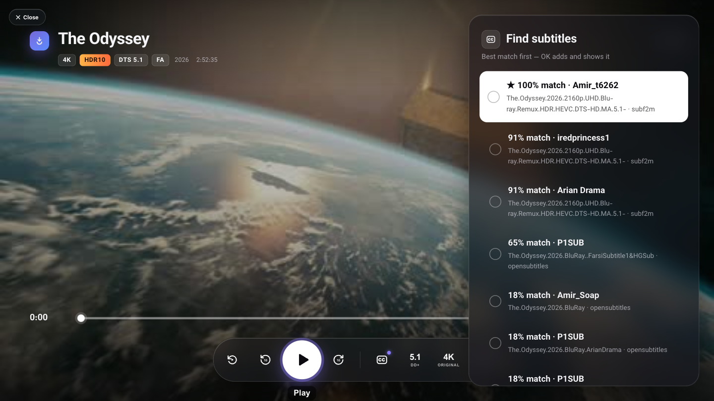

<h1 align="center">📖 dlus user guide</h1>

<p align="center">Everything dlus can do, where to find it, and how it behaves.<br>
Short version: <a href="../README.md">README</a> · Security: <a href="../SECURITY.md">SECURITY.md</a> · VPN router: <a href="VPN-ROUTER.md">VPN-ROUTER.md</a></p>

| | | |
|---|---|---|
| 📦 [1. Install and first start](#-1-install-and-first-start) | ⬇️ [2. Downloads](#️-2-downloads) | 💻 [3. Watching on the Mac](#-3-watching-on-the-mac) |
| 📺 [4. Watching on the TV](#-4-watching-on-the-tv) | ▶️ [5. The dlus player](#️-5-the-dlus-player) | 💬 [6. Subtitles](#-6-subtitles) |
| 🎞️ [7. Quality and sound](#️-7-quality-and-sound) | 🎮 [8. Remote control and TV settings](#-8-remote-control-and-tv-settings) | 🏠 [9. Sharing on your network](#-9-sharing-on-your-network) |
| 🛡️ [10. VPN router](#️-10-vpn-router) | 👀 [11. Devices and viewers](#-11-devices-and-viewers) | ⚙️ [12. Settings](#️-12-settings) |
| ⌨️ [13. Keyboard shortcuts](#️-13-keyboard-shortcuts) | 🩺 [14. Troubleshooting](#-14-troubleshooting) | 🗑️ [15. Uninstall](#️-15-uninstall) |

---

## 📦 1. Install and first start

1. Open `dlus-<version>.dmg`, drag **dlus** onto **Applications**.
2. Open it.
3. dlus installs its background service (it starts with your Mac) and opens its window.

> [!IMPORTANT]
> **The first time**, macOS says the app is from an unidentified developer: right-click **dlus** &rarr; **Open** &rarr; **Open**. You only do this once.

**What runs where**

| Part | What it does |
|---|---|
| 🪟 **The window** | only the interface. Closing it (<kbd>⌘</kbd><kbd>W</kbd> / <kbd>⌘</kbd><kbd>Q</kbd>) does not stop anything |
| ⚙️ **The background service** | downloads, streams to the TV and serves the players. To stop it completely: **dlus menu &rarr; Stop dlus Completely** |
| 🔒 **Your data** | settings, download list, subtitle files, TV pairing, activity log - in `~/.dlus`, readable only by you |

> [!TIP]
> Install **ffmpeg** for TV streaming, subtitles and previews: `brew install ffmpeg`. Python 3 comes with the Xcode command line tools (`xcode-select --install`).

Prefer the browser? **Settings &rarr; Open dlus in &rarr; my web browser**. Hold <kbd>⌥</kbd> while opening dlus to get the window once anyway; **View &rarr; Open in Browser** always works.

## ⬇️ 2. Downloads

**Add:** paste a link anywhere in the window (<kbd>⌘</kbd><kbd>V</kbd>), drop a link on it, or **New download** (<kbd>⌘</kbd><kbd>N</kbd> / <kbd>⌥</kbd><kbd>N</kbd>). Several links at once are fine - any text works, the links are picked out.

**Options in the *New download* box**

| Option | |
|---|---|
| 📁 **Folder** | a name creates a folder in your download folder; `~/Movies/...` or `/path` is used as is. Empty = sorted by type (Video, Audio, ...) |
| 🔀 **Connections per file** | 8 is a good default; more helps on fast but per-connection-limited servers |
| 🔐 **Checksum** | the publisher's checksum (`sha256:...`, a plain SHA-256 / SHA-512 / SHA-1 / MD5 value, or a line copied from their download page) **or a link to their checksum file**. dlus verifies the finished file |
| ▶️ **Start now** | untick to queue it |

### 🛡️ How it keeps the file intact

- 🧩 The file is fetched in 256 MB pieces over many connections; each piece is checked against the server at several points; a broken piece is fetched again alone.
- 🔁 Wi-Fi drop, sleep, restart: it continues where it stopped - **never from zero**. Links that expire can be refreshed by pasting the new link onto the same download.
- 🔎 **Installers, disk images and archives** (`.iso`, `.dmg`, `.pkg`, `.zip` ...): if you gave no checksum, dlus looks for the publisher's checksum file next to the download (`file.iso.sha256`, `SHA256SUMS` ...) and checks against it.
- 🍏 Every finished file gets the macOS quarantine flag (like a Safari download), so macOS checks apps and installers from it before they run.

> [!CAUTION]
> A file that does **not** match its checksum is set aside as `<name>.checksum-failed` and marked failed. **Do not open it.** **Resume** downloads it again from scratch.

### ✅ Check a file later

Open a finished download &rarr; **Integrity**:

| You do | dlus checks |
|---|---|
| look at **SHA-256** | nothing - compare it yourself with the one on the publisher's website |
| **Verify** with an empty box | the file was **not changed** since it was downloaded |
| **Verify** with a pasted checksum or checksum-file link | the file is **exactly the publisher's** |

> [!TIP]
> Example: you downloaded an installer ISO and the vendor's page shows its SHA-256 - paste it and press **Verify**.
>
> A checksum from the same server proves the file arrived intact; a checksum from the publisher's own page also proves nobody swapped the file on a mirror. **Use the publisher's when you have it.**

### 🗂️ Managing

- **Pause / resume / retry / delete** on each row; **Queue** decides the order (drag or the arrows). Settings sets how many run at once.
- **Speed limit** and a **schedule** (only between certain hours) in Settings.
- While a TV or another device is watching, downloads are limited automatically (*TV & remote &rarr; Streaming priority*), so playback does not stutter.

## 💻 3. Watching on the Mac

**Play** on any video (also while it is still downloading) opens the player in its **own window** (in browser mode: a new tab). It is the same player as on the TV - see [section 5](#️-5-the-dlus-player).

Close it with the red window button, <kbd>⌘</kbd><kbd>W</kbd>, <kbd>Esc</kbd>, or **✕ Close** at the top left.

Prefer another app? The row's menu offers IINA / VLC / mpv or a copyable stream link.

## 📺 4. Watching on the TV

### 🔗 Connect once

1. TV and Mac on the same network. On the TV turn on *Settings &rarr; General &rarr; Devices &rarr; TV Management / LG Connect Apps* (wording varies by model) and, for waking it, *Turn on via Wi-Fi*.
2. dlus &rarr; **TV & remote &rarr; Find TVs &rarr; Connect**; press **Allow** on the TV (once).
3. The first time something needs the network, dlus asks *Let your TV and other devices reach dlus?* - say yes (you can close it again under Sharing).

### ▶️ Play - the **On TV** button on a file

| Choice | When |
|---|---|
| 🏆 **LG player · best picture** *(recommended)* | the TV plays the file itself with full HDR / Dolby Vision processing, your picture mode and your subtitle. Sound: *Dolby Digital Plus 5.1* (the film's own mix, works on every LG TV) or *Untouched original* (DTS / TrueHD, only if your TV or soundbar decodes it) |
| 🎛️ **dlus player** | the dlus player on the TV, with all dlus controls (below). The TV's web browser shows a slightly weaker picture than LG's player; press **LG · BEST** in it to switch at the same position |

> [!TIP]
> **Without the Mac:** on the TV open the web browser, go to the address shown on *TV & remote*, type the 6-character code. You get a TV home page with your films and shared folders. Add it to the TV home screen from the browser menu.
>
> A new device must be **allowed** in dlus on the Mac the first time - see [section 9](#-9-sharing-on-your-network).

## ▶️ 5. The dlus player

Controls - remote: <kbd>◀</kbd> <kbd>▶</kbd> to move, <kbd>OK</kbd> to choose · mouse: hover and click · Mac keyboard: same keys, <kbd>Space</kbd> = play / pause.

| Button | What it does |
|---|---|
| ↺ Start over | play from the beginning |
| ⟲ 10 / ⟳ 10 | back / forward 10 seconds (<kbd>◀</kbd> <kbd>▶</kbd> on the remote; <kbd>⏪</kbd> <kbd>⏩</kbd> jump 30 seconds) |
| ▶ / ❚❚ | play / pause |
| **LG · BEST** *(TV only)* | hand the film to LG's own player at the same position |
| **HDR · STANDARD** *(TV only)* | shows the TV's picture mode; <kbd>OK</kbd> opens the TV's picture settings |
| **CC** | subtitles ([section 6](#-6-subtitles)) |
| **5.1 DD+ / 2.0** ... | the sound actually being played; <kbd>OK</kbd> chooses the sound mode |
| **4K ORIGINAL / 1080p** ... | the picture actually being played; <kbd>OK</kbd> chooses the quality |
| **(i)** | what is playing: picture, sound, subtitle, how much is downloaded |

- 🖼️ **Seeking** shows a preview frame from the film; the time bar shows how much is downloaded.
- ⏯️ **Resume**: reopening a film asks *Continue at ...* or *Start over*.
- ⏳ **Waiting for the download**: playing past the downloaded part pauses until more is there, then continues by itself.
- ↩️ **Back** (TV): first <kbd>BACK</kbd> hides the controls, then <kbd>BACK</kbd> twice leaves. <kbd>Esc</kbd> (Mac): closes the player.
- 🎨 Remote colour keys in the player: 🔴 subtitles · 🟢 subtitle size · 🟡 / 🔵 subtitle sync.

## 💬 6. Subtitles

### ➕ Add

**🔍 Find online** (Subtitles menu &rarr; *Find online*, or the subtitle search on the Mac) searches subf2m and OpenSubtitles for the film and lists every subtitle with a **match score**, best first. <kbd>OK</kbd> adds the chosen one, shows it and syncs it.

<p align="center"></p>

<details>
<summary><b>How the match score works</b></summary>

The subtitle's release name is compared with your file's name:

| Part of the release name | Weight | Example |
|---|---|---|
| release group (who made the video file) | 🟢🟢🟢 most | `...-GROUP` - same group = made from the very same file |
| resolution | 🟢🟢 high | `2160p`, `1080p` |
| source | 🟢 medium | `BluRay`, `Remux` (close relatives count half), `WEB-DL` |
| HDR / not HDR | ⚪ low | `HDR`, `DV` |
| video codec | ⚪ low | `x265 / HEVC`, `x264` |

</details>

> [!NOTE]
> **★ 100 %** means the subtitle was made for exactly your release - it is almost always in sync already. Lower scores are for other releases of the same film; they usually work too after **Auto sync**, unless they were made for another cut (Auto sync then says so).

- 📄 **Add file** (Mac): `.srt .ass .ssa .vtt .sub` or a `.zip` with one. The same file twice is recognised and not added again.
- 🎬 Subtitles inside the video file are listed too (text ones; image subtitles cannot be shown).

### 🎯 Auto sync

Subtitles menu &rarr; **Auto sync**: dlus listens to the film once (about a minute for a 3-hour film, cached) and fits the subtitle to where people speak.

| Result | Meaning |
|---|---|
| ✅ *synced +1.23 s · 97 % sure* | a constant shift (and, if needed, a frame-rate fix such as 25 &rarr; 23.976 fps) was applied |
| 🧩 *fitted to this cut* | the subtitle was made for another version (other intro, extra or missing scene); dlus corrected each part separately. The original file is kept |
| ❌ *does not match this version* | nothing is applied; choose another subtitle |

New subtitles are synced automatically when they are added. Fine-tune with **Sync** (0.1 s steps, 🟡 / 🔵 on the remote) - the value is saved for that film.

### 🎨 Look

Font, size, colour, background, position, bold - **one preset for every film**, on the Mac and the TV. Persian / Arabic fonts: **Fonts** in the sidebar (install, upload your own).

In LG's own player the subtitle is built into the stream at the right time (styles are LG's).

## 🎞️ 7. Quality and sound

Saved **per film**. Only choices that make sense for that file are shown.

| Quality | |
|---|---|
| 💎 **Original** | the video exactly as in the file (bit-identical). Default; *Auto* starts here and steps down only after repeated real stalls |
| 📶 **4K High / 4K Saver / 1080p / 1080p Low** | re-encoded by the Mac's video hardware for slow Wi-Fi; HDR is kept |
| ✨ **Enhanced** | only for low-resolution videos (under 720p): cleaned up and upscaled to 1080p |

> [!NOTE]
> Formats a TV browser cannot play (VP9, AV1, Xvid, ProRes, 10-bit H.264) are converted at near-original quality and marked **CONVERTED**; LG's player always gets the untouched file.

| Sound | |
|---|---|
| 🎼 **Original sound** | the film's own mix, no remix or level changes (as Dolby Digital Plus for the TV browser) |
| 🗣️ **Clear dialogue** | voices louder, for TV speakers |
| 🌙 **Night mode** | loud and quiet parts evened out |
| 🔊 **5.1 surround** | for a soundbar or home theatre |

## 🎮 8. Remote control and TV settings

**TV & remote** shows a remote like the LG Magic Remote.

- ✋ **Hold** a key for the label printed under it (INPUT, LIST, AD/SAP; hold <kbd>−</kbd> = mute; hold <kbd>Home</kbd> = recent apps). Scroll on the wheel = up / down.
- ⌨️ **Click the remote** to drive the TV with the Mac keyboard: arrows, <kbd>Enter</kbd>, <kbd>⌫</kbd> = Back, <kbd>H</kbd> = Home, <kbd>+</kbd> / <kbd>−</kbd> volume, <kbd>M</kbd> mute. <kbd>Esc</kbd> or a click elsewhere stops it.
- 📋 Right side: what is on the TV, volume slider, **type text** into the TV, inputs, installed apps, screen off / on, wake.
- 🖼️ **Picture mode**: dlus reads the TV's picture mode and opens its picture settings; LG does not let remote apps change it directly.
- 🧹 **Forget** removes the pairing; the TV asks to *Allow* dlus again next time.

> [!NOTE]
> LG lets remote apps use only some buttons outside the dlus player; when one is not allowed, dlus opens the matching screen instead or tells you.

## 🏠 9. Sharing on your network

> [!IMPORTANT]
> **Nothing is reachable from your network until you allow it** (**Sharing**), and **every device must then be allowed by you**.

| Switch | What it opens |
|---|---|
| 🌐 **Network access** | the TV player, TV home page and stream links (port 8643, secret code) |
| 📁 **Shared folders** | folders you add; they appear on the TV home page and in DLNA. macOS may ask dlus for access to Downloads / Desktop |
| 📡 **DLNA** | the TV (and other DLNA players) list dlus under media sources |
| 🧭 **Proxy** | an HTTP proxy for other devices, with a password |
| 🔄 **New secret link** | a new code; TVs must enter it, and every allowed device except paired TVs must be allowed again |

### 🛡️ Every device must be allowed

The first time a TV, phone or computer opens dlus (TV home page, a stream link, shared folders, DLNA or the proxy), it sees *Waiting for approval* and dlus shows a banner:

> ⚠️ **LG TV** asks to use dlus &nbsp;&nbsp; `192.168.1.20 · opened the TV home page` &nbsp;&nbsp; **[ Allow ]** &nbsp; **[ Deny ]**

- **Allow** - the device can watch your films, open shared folders and use the proxy.
- **Deny** - blocked for an hour.
- TVs you paired or sent a film to from the Mac are allowed by themselves.
- Allowed devices are listed under **Devices & viewers**, where **Remove** takes access away again.

> [!WARNING]
> Allow only devices you know. Approval is tied to the device's hardware address - if another device takes over the same IP address, dlus asks again.

> [!NOTE]
> Private places can **never** be shared: system folders, `~/Library`, `~/.ssh`, the dlus settings folder, and hidden files inside shared folders.

## 🛡️ 10. VPN router

Send a TV or other device through your Mac's VPN. Full manual: **[VPN-ROUTER.md](VPN-ROUTER.md)** (supported VPNs, setup, safety, troubleshooting).

```text
VPN router → Install helper (macOS password, once) → Connect a device → type the 4 values on the device → live check turns green ✅
```

Each device shows its traffic today / this month / total.

> [!WARNING]
> The VPN router is **experimental**: it changes your Mac's firewall and IP forwarding. Read [Safety](VPN-ROUTER.md#-safety) first.

## 👀 11. Devices and viewers

| Part | Shows |
|---|---|
| 📺 **Watching now** | who is watching what right now (device, film, speed) |
| 🕘 **Play history** | what was watched, by whom, how long |
| ✅ **Allowed devices** | everything that may use dlus, with **Remove** |
| 📜 **Activity log** | devices asking for access, allowed or denied, wrong codes, streams started, sharing / proxy / VPN router turned on or off, the root helper installed, downloads added, checksum results and refused files |

Devices are named by their network names (Bonjour / your router); unnamed phones and tablets with private Wi-Fi addresses are labelled as such. Rename a device by clicking its name (VPN router page).

## ⚙️ 12. Settings

**Settings** (<kbd>⌘</kbd><kbd>,</kbd>): download folder, downloads at the same time, connections, speed limit, limit while watching, schedule, what to do when all downloads are done, notifications, open dlus in window or browser.

> [!NOTE]
> **Unencrypted remote control for older TVs** is off. Turn it on only if your LG TV is from before about 2018 and *Connect* says its encrypted remote-control service cannot be reached.

🔔 The bell (top right) collects notifications: finished downloads, new devices, errors. The same events appear in the macOS Notification Center with the dlus logo (macOS asks once to allow them; change it in *System Settings → Notifications → dlus*). Turn them off in Settings.

## ⌨️ 13. Keyboard shortcuts

| App menu | Browser and app | |
|---|---|---|
| <kbd>⌘</kbd><kbd>N</kbd> | <kbd>⌥</kbd><kbd>N</kbd> | new download |
| <kbd>⌘</kbd><kbd>F</kbd> | <kbd>⌥</kbd><kbd>F</kbd> | search |
| <kbd>⌘</kbd><kbd>,</kbd> | <kbd>⌥</kbd><kbd>,</kbd> | settings |
| <kbd>⌘</kbd><kbd>1</kbd> … <kbd>⌘</kbd><kbd>0</kbd> | <kbd>⌥</kbd><kbd>1</kbd> … <kbd>⌥</kbd><kbd>0</kbd> | sections (All, Active, Queue, Finished, Library, Network, Devices, Sharing, VPN router, TV) |
| | <kbd>⌥</kbd><kbd>T</kbd> | light / dark |
| | <kbd>⌘</kbd><kbd>K</kbd> | command menu (every action and download) |
| | <kbd>⌘</kbd><kbd>V</kbd> | paste links anywhere |

Shortcuts never fire while you type in a field. In the player: <kbd>Space</kbd> play / pause, <kbd>◀</kbd> <kbd>▶</kbd> seek, <kbd>Esc</kbd> close (Mac).

## 🩺 14. Troubleshooting

| Problem | Try |
|---|---|
| 📺 TV not found / "host is down" | TV on and on the same Wi-Fi; turn on *TV Management / LG Connect Apps* and *Turn on via Wi-Fi* |
| 🔇 No sound in LG's player | choose *Dolby Digital Plus 5.1* for LG player (the TV has no DTS-HD decoder) |
| ⏳ Player keeps buffering | Quality &rarr; 4K Saver or 1080p, or turn on the streaming limit; Wi-Fi under ~60 Mbit/s cannot carry an untouched 4K remux |
| 💬 Subtitle off | Subtitles &rarr; Auto sync; if it says *does not match this version*, choose another subtitle |
| 📁 A shared folder is empty on the TV | macOS privacy: allow dlus (or Python) access to that folder, then restart dlus |
| ⏸️ A device shows *Waiting for approval* | press **Allow** on the banner in dlus on the Mac |
| 🔐 *Checksum mismatch* | the file is not the publisher's - do not open it; check the link or the checksum, then **Resume** |
| 📡 The TV's certificate changed | if you reset or updated the TV: **TV & remote &rarr; Forget**, then connect again. Otherwise someone may be listening on your network |
| 🛡️ VPN router | see [VPN-ROUTER.md](VPN-ROUTER.md#-troubleshooting); **Check routes** on the page |
| ❓ Anything else | `~/.dlus/dlus.log` and `~/.dlus/launchd.log` |

## 🗑️ 15. Uninstall

1. **dlus menu &rarr; Stop dlus Completely** (or run *Uninstall dlus.command* from the disk image - it also removes the VPN-router helper).
2. Drag **dlus** from Applications to the Trash.
3. Delete `~/.dlus` to remove settings, download list and subtitles (your downloaded files stay).
